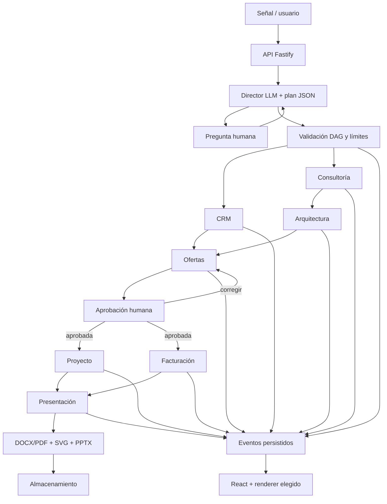

# Arquitectura de referencia



## Elección inicial

TypeScript extremo a extremo, React + Vite, Node + Fastify, Zod, Responses API, PptxGenJS para PPTX, una librería DOCX y conversión/render determinista a PDF, conocimiento Markdown/JSON. Un proceso para API y frontend compilado. Para local, filesystem con escritura atómica; para Azure, Blob para snapshots/eventos/artefactos y una sola réplica. No usar Blob como cola transaccional multiworker. El ejecutor tiene concurrencia limitada, persiste estado y **sabe pausar y reanudar** en una aprobación humana.

El frontend usa polling incremental `after` ~1 s. SSE es alternativa; WebSocket no imprescindible. Se reconstruye desde snapshot + eventos, nunca desde animaciones. Separar modelos, herramientas y renderer por interfaces. No guardar ni transmitir razonamiento privado del modelo: solo resúmenes operativos, entradas/salidas autorizadas y eventos.

## Orquestador

1. Validar la señal o petición, registrar idempotency key y crear el run.
2. El director devuelve un plan estructurado. Si necesita una decisión de alcance, emite `human.message` y espera.
3. Validar tipos, IDs únicos, agente permitido, dependencias existentes, DAG acíclico, máximo 8 tareas y herramientas permitidas.
4. Ejecutar las tareas ready en paralelo (máximo 2).
5. Cada especialista recibe contexto mínimo y resultados de dependencias.
6. Validar la salida JSON y generar artefactos de forma determinista.
7. Al llegar a la tarea marcada `requiresApproval`, emitir `approval.required`, persistir el snapshot y **pausar**. No consumir tokens mientras se espera.
8. Con la respuesta humana, emitir `approval.resolved` y `run.resumed`. Si la persona corrige, permitir **una** replanificación controlada; nunca bucles abiertos.
9. Ejecutar proyecto y facturación, generar la presentación, consolidar y cerrar con estado terminal explícito.

Ruta prevista: 6–8 llamadas LLM (director, CRM, consultoría, arquitectura, ofertas, presentación, y opcionalmente proyecto/facturación). Proyecto y facturación pueden ser deterministas para no gastar tiempo. Límite propuesto: timeout por tarea 30–45 s configurable; fase 1 objetivo 90 s, aprobación 15–20 s, fase 2 40 s, total 150–180 s. Medir; no garantizar 60 s. No generar DOCX/PDF/PPTX con código arbitrario del LLM: las herramientas aplican plantillas a JSON validado. El SVG se genera desde nodos y conexiones con texto escapado.

## Interacción humana

- El director pregunta por una decisión de alcance (por ejemplo, «¿incluimos formación?»). La respuesta modifica el plan antes de ejecutar.
- La aprobación de la oferta es una puerta obligatoria. La UI muestra el estado «esperando aprobación» y el botón de aprobar/corregir.
- Cada mensaje humano es un evento (`human.message`), con autor, timestamp y tarea relacionada. No se guardan conversaciones privadas fuera del run.
- Si no hay respuesta en el tiempo de demo, el run queda pausado y se muestra el estado; no se inventa una aprobación.
- La persona puede corregir una vez. La replanificación se registra y no se repite en bucle.

## Modelos de noviembre de 2026

Para agentes: **GPT-6.1 Sol** en dirección y arquitectura; **GPT-6.1 Terra** en especialistas de alto volumen. Para código, diseño y tareas de alto volumen: **GPT-6 Luna**. GPT-6.2 Astra/Sol queda como opción si el tenant lo tiene y la evaluación justifica el coste.

| Modelo | ID de catálogo | Uso |
|---|---|---|
| GPT-6.1 Sol | `gpt-6.1-sol` (2026-09-29) | Director, arquitectura, decisiones |
| GPT-6.1 Terra | `gpt-6.1-terra` (2026-10-26) | Especialistas rápidos, visión y computer use |
| GPT-6 Luna | `gpt-6-luna` (2026-09-22) | Código, diseño, alto volumen |
| GPT-6.2 Astra | `gpt-6.2-astra` (2026-11-17) | Opción de máxima calidad si hay cuota |

Usar el nombre real del deployment del tenant, no asumir que coincide con el identificador del catálogo. Verificar región, cuota, precio, parámetros y latencia. Adaptador de proveedor + mocks. No exigir preview para el MVP. Un modelo local compatible sirve para experimentar, pero no equivale a calidad ni latencia.

Alternativas: Agents SDK si hay handoffs/tools loop y tracing; Agents API gestionada si se verifica disponibilidad; Microsoft Agent Framework/Magentic para coordinación compleja; LangGraph para grafos durables. Para ocho perfiles y un checkpoint de aprobación, el DAG propio sigue siendo suficientemente transparente. No usar MCP si una función TS sencilla resuelve la integración.

## Contratos que cambian

- `plan.schema.json`: `agent` admite `crm`, `offers`, `delivery`, `billing`; máximo 8 tareas; `requiresApproval` opcional.
- `event.schema.json`: `agent_id` admite los nuevos roles; se añaden `run.paused`, `run.resumed` y `human.message`.
- `types.ts`: `AgentId`, `PlanTask.requiresApproval`, `HumanMessage`, estado `paused`.
- `ProjectSnapshot.status`: añadir `paused` además de `running`, `completed`, `failed`, `cancelled`, `interrupted`.

## Repositorio objetivo (después de iniciar implementación)

```
apps/web/           # UI y renderer elegido
apps/api/           # endpoints, executor, checkpoint y provider
packages/core/      # tipos, reducer y máquina de estados
packages/agents/    # prompts, tools y esquemas
packages/documents/ # plantillas DOCX/PDF, PPTX, SVG
assets/             # importaciones permitidas y licencias
knowledge/          # fichas públicas y ficticias
scenarios/          # fixtures y replay
infra/              # Docker y despliegue
```

Estos archivos todavía no son una aplicación con dependencias instaladas. `07_CONTRATOS/` es punto de partida; el checkpoint de aprobación es el cambio principal respecto a la versión anterior.
