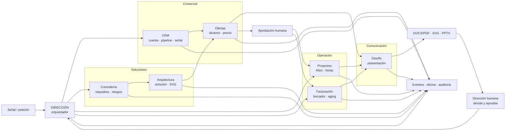
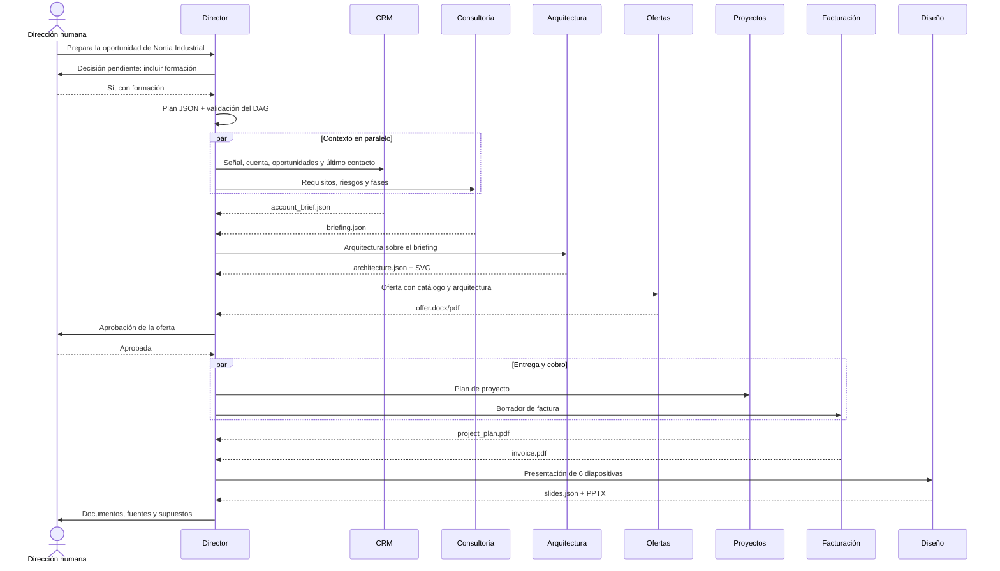
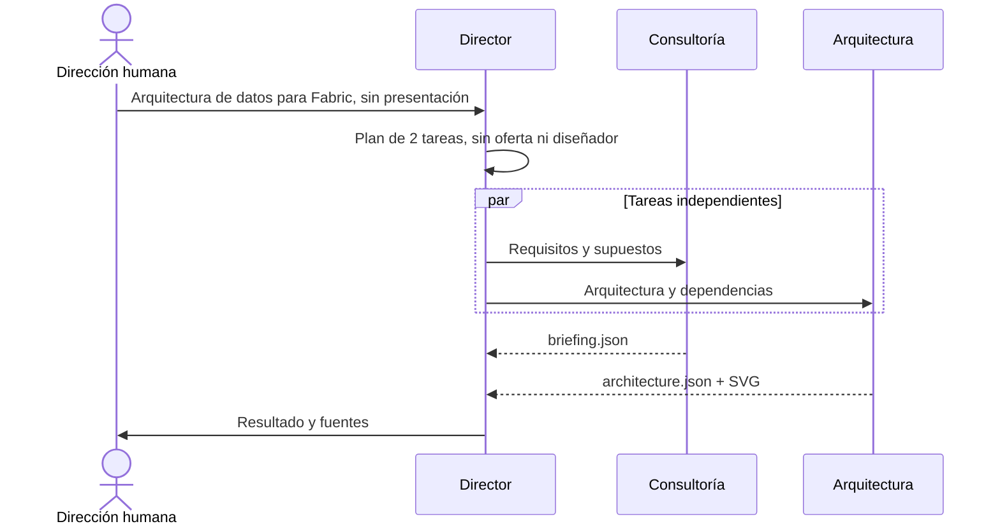

# Esquema de la empresa agéntica · Integra HQ

> Revisión 25/11/2026. **Decisión cerrada:** un ciclo completo de negocio con 8 agentes, intervención humana y documentos reales. No es una demo de cuatro piezas sueltas.

## 1. Tesis

Una dirección delega un trabajo completo y puede verlo, corregirlo y aprobarlo. Integra HQ coordina especialistas sobre el ciclo real de una consultora: señal de oportunidad, cuenta, solución, oferta, aceptación, proyecto y cobro. La oficina visual es la interfaz de confianza; el valor está en los documentos y en las decisiones registradas.

Tres reglas:

1. **El director planifica; los especialistas ejecutan; el humano decide.** Ningún agente envía una oferta, publica una factura ni compromete al cliente.
2. **Los números, fechas y precios se calculan en código contra datos versionados.** El LLM interpreta, redacta y propone; no inventa importes ni condiciones.
3. **La oficina se mueve con eventos reales.** Si no hay evento, no hay animación; la espera y el error se muestran como son.

## 2. Organigrama

## 3. Registro de agentes

| ID | Zona | Misión | Entradas | Herramientas | Salida | Límite |
|---|---|---|---|---|---|---|
| `director` | Dirección | Interpretar, planificar, preguntar, validar, pausar y consolidar | Señal, registro, políticas | `plan`, `ask_human`, `validate_plan`, `request_approval` | `plan.json`, resumen | No redacta el contenido de los especialistas |
| `crm` | Comercial | Leer cuenta, oportunidad, último contacto y pipeline | `account_id`, `as_of` | `read_crm`, `search_knowledge` | `account_brief.json` | Solo lectura |
| `offers` | Comercial | Oferta con alcance, fases, supuestos y banda de precio | Brief, arquitectura, catálogo | `read_catalog`, `build_offer` | `offer.docx/pdf` + JSON | Borrador; no envía |
| `consultant` | Soluciones | Requisitos, riesgos y fases | Petición, conocimiento | `search_knowledge` | `briefing.json` | Sin datos de cliente salvo el brief |
| `architect` | Soluciones | Componentes, dependencias y SVG | Briefing | `search_knowledge`, `generate_architecture` | `architecture.json` + SVG | Sin ejecutar código del LLM |
| `designer` | Comunicación | Narrativa y presentación de 6 diapositivas | Resultados | `generate_presentation` | `slides.json` + PPTX | Plantilla local |
| `delivery` | Operación | Plan de proyecto, hitos, horas y riesgos | Oferta aprobada | `read_projects`, `build_project_plan` | `project_plan.pdf` + JSON | Determinista; no inventa esfuerzo |
| `billing` | Operación | Borrador de factura y aging | Oferta, contrato, hitos | `read_billing`, `build_invoice` | `invoice.pdf` + JSON | Borrador; no contabiliza |

Los agentes no comparten memoria libre. El director entrega contexto mínimo y resultados de dependencias. Ofertas y diseño aplican `knowledge/writing_style.md`; ofertas sigue `knowledge/proposals.md`.

## 4. Flujo principal · ciclo completo

Petición: «Nortia Industrial ha ampliado su proyecto. Prepara la oportunidad, la oferta y el arranque del proyecto.»

**Criterio de aceptación:**

- La pregunta humana cambia el plan: con formación se añade una fase; sin ella, no.
- La oferta se pausa antes de salir; la aprobación reanuda el run sin repetir tareas.
- La oferta, el plan y la factura son DOCX/PDF abribles; el JSON es interno.
- La factura es un borrador; no se contabiliza ni se envía.
- Cada estado de la oficina tiene un evento.
- 6–8 llamadas al modelo; 150–180 s objetivo; si se pasa, se recorta la presentación o se usa replay.

## 5. Flujo secundario · solución puntual

Petición: «Diseña una arquitectura de datos para Microsoft Fabric; no prepares presentación.»

Este flujo demuestra la selección variable del equipo. Si la petición es vaga, el director añade la dependencia `consultant → architect`; no paraleliza de forma artificial.

## 6. Contratos y estados

- `plan.schema.json`: `agent` admite los 8 roles; máximo 8 tareas; `requiresApproval` opcional.
- `event.schema.json`: `agent_id` admite los 8 roles; se añaden `run.paused`, `run.resumed` y `human.message`.
- `types.ts`: `PlanTask.requiresApproval`, `HumanMessage`, estado `paused`.
- La ejecución se persiste como snapshot + eventos; la reanudación no repite tareas ya completadas.
- El razonamiento privado del modelo no se guarda ni se envía.

## 7. Datos y herramientas

| Fuente | Contenido | Uso |
|---|---|---|
| `crm/accounts.json` | Cuenta, oportunidades, actividades, último contacto | CRM |
| `catalog/services.json` | Servicios aprobados y bandas de precio | Ofertas |
| `projects/portfolio.json` | Hitos, horas, riesgos | Proyectos |
| `billing/invoices.json` | Facturas, vencimientos, pagos | Facturación |
| `knowledge/*.md` | Fichas públicas y metodología | Consultoría y arquitectura |

Herramientas principales: `read_crm`, `read_catalog`, `build_offer`, `generate_architecture`, `generate_presentation`, `read_projects`, `build_project_plan`, `read_billing`, `build_invoice`, `ask_human`, `request_approval`.

Guardas: solo lectura en CRM/ERP; ninguna herramienta envía correo, firma una oferta o contabiliza una factura. Los importes salen del catálogo o de una persona. Los documentos se generan desde plantillas y JSON validado, no desde código arbitrario del LLM.

## 8. Oficina visual

| Zona | Agentes | Qué se ve |
|---|---|---|
| Dirección | `director` | Mesa central, plan, pregunta y aprobación |
| Comercial | `crm`, `offers` | Pipeline, cuenta y documento de oferta |
| Soluciones | `consultant`, `architect` | Pizarra, requisitos y diagrama |
| Comunicación | `designer` | Pantalla de diapositivas |
| Operación | `delivery`, `billing` | Plan de proyecto y factura |

La oficina actual tiene cuatro puestos; el alcance nuevo necesita **cinco zonas y ocho roles**. Los agentes pueden compartir zona cuando no trabajan a la vez. El renderer (2D, 3D o prerender) se decide tras el spike A/B/C; la escena debe leerse en 3 segundos.

Reglas de animación: `task.started` sitúa al agente; `tool.started` muestra búsqueda o escritura; `artifact.created` hace aparecer el documento; `task.failed` es rojo; `approval.required` muestra el sobre y el estado de espera. Sin evento no hay movimiento.

## 9. Corte del MVP

| Capa | P0 · demo | P1 | Fuera |
|---|---|---|---|
| Agentes | 8 roles del ciclo | más áreas | HR, marketing, IT |
| Flujo | ciclo completo + solución puntual | conectores reales | autonomía 24/7 |
| Datos | fixtures CRM, catálogo, proyectos, facturación | tenant Dynamics/Business Central | CRM/ERP reales |
| Documentos | oferta, plan, factura, SVG, PPTX | plantillas corporativas aprobadas | firma, envío, contabilización |
| Visual | 5 zonas, 8 roles, eventos reales | más personajes/animaciones | 3 plantas, multijugador, voz |

## 10. Decisiones tomadas (25/11/2026)

1. **Historia:** ciclo completo, con el flujo de solución puntual como segunda combinación.
2. **Agentes:** 8; proyectos y facturación entran en la demo, simulados y deterministas.
3. **Precio:** banda de catálogo marcada «pendiente de validación»; nunca precio libre.
4. **Documentos:** oferta, plan y factura en DOCX/PDF; JSON interno.
5. **Plantilla:** Integra; no se usa la estructura de Asenta.
6. **Modelo:** GPT-6.1 Sol/Terra para agentes; GPT-6 Luna para código y diseño.
7. **Visual:** decidir renderer después del spike; la oficina es P0.
8. **Datos:** fixtures sintéticas; sin CRM/ERP reales.
9. **Repo:** público `integra-hq`, marca para el hackathon, no producto oficial.

## 11. Qué no hacer

- No añadir un noveno agente antes de que los ocho funcionen de extremo a extremo.
- No conectar CRM/ERP reales ni enviar correos.
- No dejar que el LLM escriba precios, condiciones legales o facturas.
- No animar trabajo que no ha ocurrido.
- No copiar la plantilla de Asenta ni presentar Integra HQ como producto oficial.
